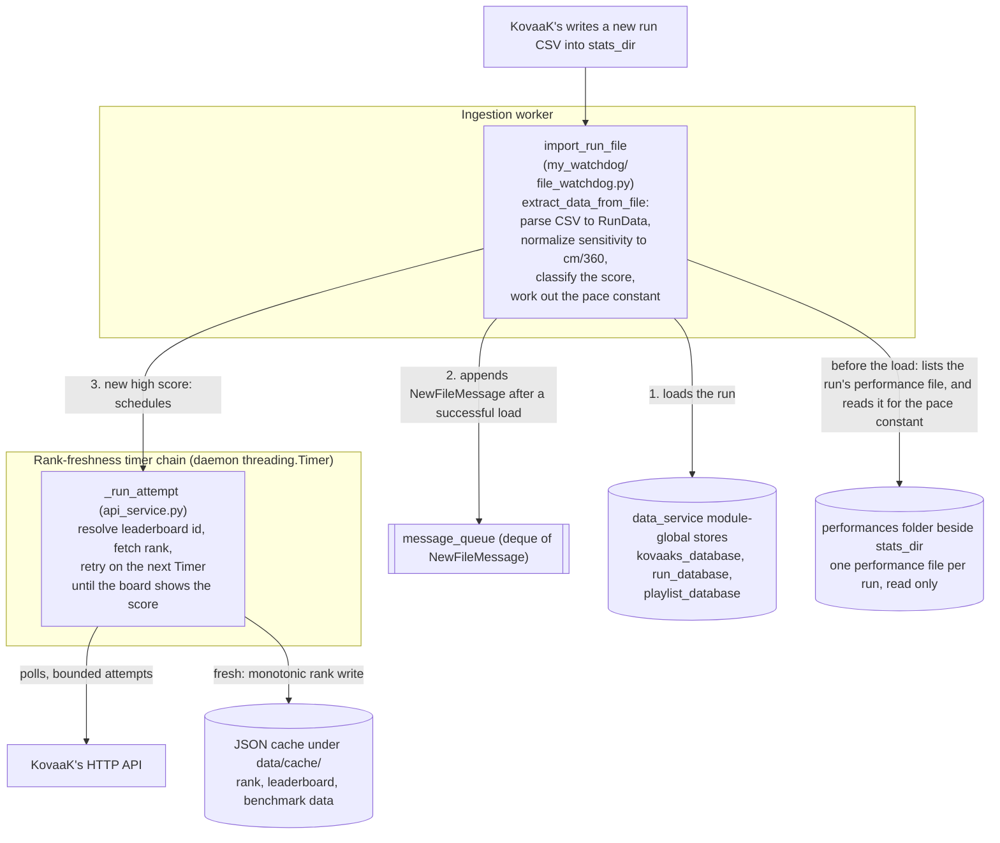
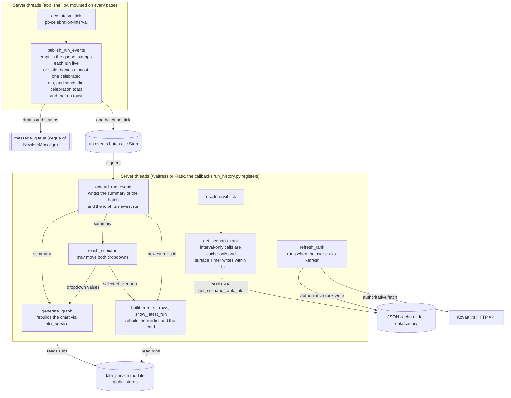
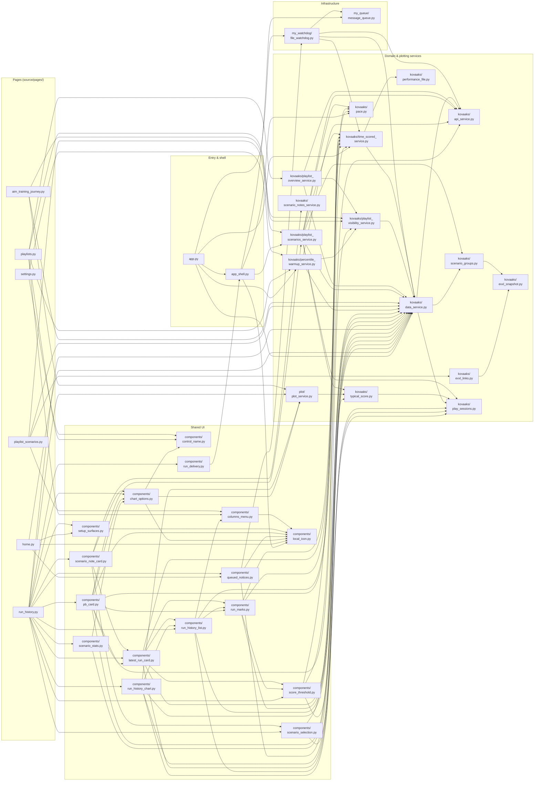

# Architecture

A map of the codebase: what each module owns and how data moves at runtime.
This is the "where does X live" index so you don't have to re-read the tree.

For the *why* behind specific choices, see `docs/decision_log/`; for KovaaK's
endpoint behavior see `docs/kovaaks_api_notes.md`; for workflow/conventions see
`AGENTS.md`. This file intentionally does not restate those.

## Process & threads

`source/app.py` (`main`) loads config, detects the stats directory when nothing
ever configured one (`stats_dir_detection.bootstrap_stats_dir`, before the pin
so a first detection serves this boot), pins the stats directory for the process
(`settings_service.resolve_stats_dir`), calls `initialize_kovaaks_data` to build
the in-memory stores from existing CSVs, lists the `performances` folder beside
it (`time_scored_service.index_performance_files`, which parses nothing), starts
a watchdog `Observer` on the stats directory and one `run-import` writer, and serves the Dash app with
Waitress (Flask dev server when `config.debug`). With no usable stats directory — unset, or set but missing —
the scan and the observer are both skipped and the app serves empty pages; only
`port` is needed to serve.

Threads at runtime:

- **Server thread(s)** — Waitress (8 workers) or Flask serving Dash; runs the
  page callbacks.
- **Watchdog observer thread** — `NewFileHandler` queues created, modified,
  and renamed CSV paths without doing file I/O.
- **Ingestion worker** — one `run-import` thread waits for per-file deadlines,
  retries unfinished files, writes the stores, and queues run notifications.
- **Rank freshness timers** — after a new high score, `api_service.py` uses a
  bounded chain of daemon `threading.Timer` attempts to poll until KovaaK's
  leaderboard reflects the local score.
- **Percentile warmup worker** — one daemon thread fills stale rank/total
  caches for played scenarios in visible playlists, yields to recent
  interactive activity, and blocks on a condition variable when idle.
- KovaaK's GETs use a **thread-local `requests.Session`**; cache file I/O is
  guarded by a single `threading.RLock` (`_CACHE_IO_LOCK` in `api_service.py`).

## Runtime data flow

Two halves of one flow, split for readability; the `message_queue`,
`data_service` stores, and JSON cache nodes are the shared state where they
meet. Each arrow is an action performed by its source node.

Ingest — the ingestion worker side (writes):

UI — the server side (pull-based reads):

The ingestion worker and UI share two channels: `message_queue` (a `deque`) carries
*notifications* that new data exists, while the run data itself is shared through
the `data_service.py` module-global stores the UI reads directly. Note the order
above — the run is loaded into the stores before its message becomes visible.
The UI is pull-based: a `dcc.Interval` in the app shell drains the entire queue
each tick and publishes one batch for whatever page is open. The page reads that
batch and never accesses the queue directly, so run delivery does not depend
on any one page being mounted.

The diagram shows the Run History page's callbacks (`run_history.py`), which
consume the batch in three steps: `forward_run_events` writes the summary,
`reach_scenario` moves the two dropdowns from it, and `generate_graph`
rebuilds once both have settled. Its run list and its latest-run card are
rebuilt for every batch, on whatever scenario, since a run on another one
can change a session row's counts and which session the card's run is in:
the same answer of
`forward_run_events` also writes the id of the batch's newest run, which
`build_run_list_rows` and `show_latest_run` take as an `Input`.

### Background threads never drive UI outputs

Dash outputs — including the notification container's `sendNotifications` —
belong to callbacks. A background thread that has something to say **publishes
it to typed shared state that an interval callback polls**; it never reaches
into the UI. There is deliberately no general event bus and no level-driven
bridge: a channel carries one kind of event, and its consumer decides what, if
anything, the user sees. Anything else lets a call site's log level stand in
for the judgment of whether an event is worth interrupting someone for.

The sanctioned channels, each typed and single-purpose:

- `my_queue/message_queue.py` — `deque[NewFileMessage]`, run events only,
  drained by the app shell's `publish_run_events` on every page. It carries
  facts about a run and no decision field, so each consumer derives its own
  verdict and two of them can never disagree about one run. One fact is
  `pace_constant`, the constant of a time-scored scenario, which the
  watchdog works out before it queues the message so that the drain and the
  page read no store for it.
- `data_service.playlist_startup_warning_queue` — boot-time playlist warnings,
  drained by a one-shot interval callback on Home and on Run History.
- `file_watchdog.run_import_failure_queue` — run files the ingestion worker
  could not import after bounded retries, drained by an interval callback on
  Home and on Run
  History into one red toast. The callbacks that drain these two queues are
  defined in `components/queued_notices.py`. Home and Run History each
  register both on intervals of their own, so whichever of the two pages is
  open drains them.
- The JSON caches under `data/cache/` — the rank pipeline: refresh Timers
  write, cache-only interval reads pick the value up on the next tick.
- `playlist_scenarios_service._FILL_REGISTRY` — the progressive fill's
  generation-scoped rows and terminal tombstones, drained by the playlist
  scenarios page's interval callback into AG Grid transactions and a status
  line. Each generation's state holds its scenario names and, captured with
  them, each scenario's rank ladder and its group, which the cancelled-fill
  rebuild needs so its rows keep Rank, Next Rank, Category, and Subcategory;
  all three are released on terminal consumption. It also holds the table
  build's typical-score snapshot, so the fill's rows and the rebuild show the
  typical values phase 1 showed. It carries grid rows, not notifications: the fill emits no
  toast at all
  ([2026-08-22](decision_log/2026/2026-08-22-the-playlist-fill-reports-degradation-in-place-only.md)).

A background event that fits none of these gets its own typed queue or polled
state, not a field grafted onto someone else's schema.

## State

- **Two filesystem roots** (`utilities/paths.py`). Every mutable path below is
  relative to the **state root**: `config.toml` and everything under `data/`.
  It is `CSD_STATE_DIR` when set (the launcher owns that variable; the app only
  reads it) and the current working directory otherwise, so a dev checkout
  behaves exactly as it always has. Read-only assets that ship with the code —
  `resources/benchmarks/` and the Evxl benchmark snapshot,
  `resources/evxl/benchmarks.json` — resolve against the **package root** instead
  (derived from `__file__`), because a deployed install runs code from a
  per-version directory while state lives at the install root.
- **In-memory only, no database.** `data_service.py` holds the live stores as
  module globals, rebuilt from CSVs on every startup:
  - `kovaaks_database` — scenario stats keyed by scenario name
  - `run_database` — a `SortedList` of all runs ordered by time
  - `playlist_database` — loaded playlists keyed by code. Startup loads
    top-level JSON files from the bundled `resources/benchmarks/` library
    (all of it — visibility, not file presence, decides what users see) and user
    `data/playlists/` second; the first file for a code wins, duplicate-code
    files warn visibly after the UI mounts, and a missing user root is treated
    as empty. New imports are written atomically under `data/playlists/`.
- **Performance files, listed and remembered in memory.**
  `time_scored_service.py` holds the names in the `performances` folder
  beside the stats directory, listed once at startup, plus each parsed
  file's answer keyed by file name. The watchdog adds a landed run's file to
  the listing. Nothing is parsed until a surface asks about a scenario, and
  nothing is written to disk.
- **Cache layer** — KovaaK's API responses and resolved rank/leaderboard data
  persist as JSON under `data/cache/` (not committed), written atomically and
  read tolerantly. Subtrees include `scenario_leaderboards/`,
  `user_scenario_total_play/`, `leaderboard/totals/`, `benchmarks/`, and
  per-scenario rank files. TTLs and rationale live in `docs/decision_log/`.
- **User settings** — `data/settings.json` (not committed) holds the app-owned
  user settings (`config/settings_service.py`): the stats directory and the
  KovaaK's identity. Written atomically and whole, read once and cached
  in-process; a missing key, an empty value, and an unusable file all mean "not
  configured". `stats_dir` is additionally pinned at startup and read from the
  pin by every consumer, so it can only change across a restart.
- **Playlist visibility** — `data/playlist_visibility.json` (not committed)
  holds the playlist show-list (`playlist_visibility_service.py`): written
  atomically on each show/hide, read once and cached in-process, absent until
  the first show/hide (reads fall back to the first-run seed).
- **Scenario notes** — `data/scenario_notes/` (not committed) holds the
  player's notes (`kovaaks/scenario_notes_service.py`), one file per scenario,
  named from the scenario's name as the app holds it through `safe_file_key`,
  so names that differ only by case get a file each. A note is read from disk
  each time it is asked for and never cached: its path comes from the name, so
  nothing scans the folder. A save writes one file atomically, and saving empty
  text deletes it. The folder is absent until the first save.
- **Schema stamps** — the durable stores above (settings, visibility, each
  user playlist under `data/playlists/`, and each scenario note under
  `data/scenario_notes/`) carry a top-level integer `"schema_version"`. User
  playlists and scenario notes are a store per file, each classified on its
  own. The read machine lives once in
  `utilities/store_schema.py` and has four states per store: *missing* is the
  first-run default; *error* (unreadable, not JSON, no stamp, a malformed or
  non-positive stamp, or a supported stamp whose payload fails validation)
  preserves the bytes, reads as the first-run default, and reports an
  actionable message that names the store by the kind its caller passes
  ("settings file") and closes with a `File: {path}` readout; *supported*
  reads normally; *future* (a stamp above the
  highest supported) reads nothing and refuses every write with
  `UnsupportedSchemaError`. There is no missing-means-v1 grandfather rule.
  Automatic writers (`bootstrap_stats_dir`) decline in the error and future
  states; user-initiated saves own an error-state file after copying it to an
  adjacent `<name>.corrupt-<n>.bak`; every scenario note write is a user's
  save. The error and future states surface in the
  UI — an alert on the settings page, one on the Playlists page for visibility,
  and the startup warning queue for playlist files. A scenario note's message
  shows on that scenario's note card on Run History, the one place a player
  meets the file. The bundled corpus is
  exempt (it ships with its reader), and `data/cache/` is deliberately
  unstamped. `scripts/stamp_schema_version.py` is the one-time conversion for
  installs created before the stamp; scenario notes were born stamped and
  aren't in it. Rationale and the run ordering are in
  `docs/decision_log/`.

## Module map

Import dependencies between the main modules. `config/config_service.py` and
`utilities/` are imported nearly everywhere and are omitted; the subsections
below carry the per-module detail.

### Entry & shell
- `source/app.py` — entry point (`main`): wiring described above.
- `source/app_shell.py` — top-level layout (`layout`): navbar (one `nav_link`
  per `NAVBAR_LINKS` entry; burger collapse applied by a clientside callback,
  and the open page's link marked by another, which follows the shell's
  read-only `navbar-location` `dcc.Location` and writes `aria-current` on the
  links), theme toggle, Dash `page_container`,
  and the notification host — the one `dmc.NotificationContainer`, plus the
  `toast-channel-registry` `dcc.Store` beside it, holding each toast channel's
  current instance id so the next emission knows which one to hide,
  shell-hosted so its lifecycle matches the toasts' rather than resetting when
  a page remounts.
  It also hosts the app-wide run-event drain: `pb-celebration-interval` (period
  `polling_interval`), the `run-events-batch` `dcc.Store`, and the
  `publish_run_events` callback that is `message_queue`'s only consumer.
  The same callback sends both toasts a run can earn, in the response that
  publishes the batch: the personal best celebration, and the plain run
  toast for the batch's newest live run, whose link
  `playlist_scenarios_service.scenario_run_history_href` builds. When one
  response carries both, `channel_toasts` builds the one registry patch.
  The Run notifications setting is the shell's `run-notifications` store
  (`storage_type="local"`, `"on"` or `"off"`), which the Settings page
  edits and the drain reads as `State`.
  Beside them sit the celebration's two other stores: `pb-celebration-style`
  (`storage_type="local"`, default `"confetti"`), which *is* the setting the
  Settings page edits and the drain reads as `State`, and
  `pb-celebration-signal`, a dead-end output that exists only because the
  clientside callback driving the animation needs one. That callback takes the
  batch store as its `Input` and the style store as `State` and calls
  `window.pbCelebration.celebrate` in `assets/pbCelebration.js`, so the burst
  costs no server round trip. That
  interval polls on every page for the life of the tab, so roughly one request
  a second is what idle looks like in devtools and in the waitress log —
  accepted for a local single-user app, and recorded here so nobody reads the
  traffic as a bug. Folding the Run History interval's other
  consumers into this one is a refactor for another day.
  The layout is built while `source/app.py` is imported, before startup
  validates the config file, so `_drain_interval_ms` falls back to the field
  default rather than turning a bad config into an import traceback.

### Pages (`source/pages/`, Dash Pages — one file per route)
- `home.py` (`/`, with `/home` and `/index` redirecting to it) — the Home
  page, the one the launcher opens. Its layout takes every query parameter
  and reads none. It draws `stats_dir_hint` and the first-run setup card
  (`setup_card_children` of `components/setup_surfaces.py`, asked for with
  the account offer), then `stats_line()`: one sentence counting the runs
  and the scenarios in the run store, from one
  `data_service.get_scenario_stats_snapshot()`, drawn only while a stats
  folder is usable and worked out once, as the page is drawn.
  The card is suppressed while a stats-directory change awaits a restart. It
  asks the store's read state before anything else: an `ERROR` or `FUTURE`
  settings file gets a card of its own, because those states read as no keys
  and the key-absence states below would take them for a fresh install.
  Otherwise it renders while a settings key has never been written — an
  absent `stats_dir`, or an absent `kovaaks_username` once the directory
  exists. It only links to `/settings`; its Skip button is answered by this
  page's `skip_identity_setup`, which calls
  `settings_service.decline_identity` and removes the card. Key *presence* is
  the line between it and `stats_dir_hint`, which explains a directory that
  is configured and unusable.
  The page also registers the two flushes of `components/queued_notices.py`
  on intervals of its own, failed run imports on its polling interval and
  the startup playlist warnings on a one-shot interval, so a warning raised
  at startup shows on the page the launcher opens.
- `run_history.py` (`/run-history`) — the Run History page: the top row, the
  chart with its Chart options panel, and the run list in a column beside the
  chart. The list's column is as wide as its shown columns need, which a
  clientside callback registered by `register_run_list()` writes to the
  page root's `style` as `--run-history-list-need`; the stylesheet clamps it
  above `--run-history-list-width`, the list's 480px minimum, while reserving
  480px for the chart where possible. The default columns and mount fallback
  still need 500px, and a 500px floor on the maximum preserves the default
  list in narrow windows. The top row is a grid with the same gap, whose
  second column is the latest-run card's own `--run-history-card-width`,
  500px, so the card lines up with the default list independently of the
  list's minimum.
  The first column (`_top_row`, `_dropdown_column`) is a
  wrapping row of the dropdowns' column, the scenario note card, and a
  `run-history-score-pair` wrapper holding Scenario Stats then the PB card.
  The wrapper carries `margin-left: auto`, so spare room sits before both
  scores and they wrap together to the column's right end, beside the
  latest-run card. At a page area of 900px or less both wrappers become
  `display: contents`, leaving one wrapping row in DOM order. Each dropdown's
  field is a grid in which the Select's own box lays out nothing, so the
  stylesheet places the Select's siblings, never in its label: the link on the playlist filter label's line,
  and the Follow switch under the scenario dropdown, small
  (`settings_help_label`'s `icon_size`) so the row is 141px at 2560px. It
  never imports another page's module: what it shares with Home is under
  `components/`.
  Every id it draws is its own (`SCENARIO_SELECTION_IDS`, `CHART_OPTIONS_IDS`,
  `SCENARIO_STATS_IDS`, and the constants beside them), its stores and
  intervals included, because a page that holds one output of a callback has
  to hold every input of it. The browser stores each remembered control's
  value under its id, so changing one resets that value for every user.
  Run delivery is three callbacks. `forward_run_events` takes the shell's
  `run-events-batch` store as its only `Input`, summarizes it for the shown
  scenario with `summarize_run_events` of `components/run_delivery.py`, and
  writes this page's summary store. It writes neither dropdown. The Follow
  switch and the scenario dropdown are `State` there, not `Input`: a Store
  replays its last value, so a control flip would otherwise forward again a
  batch already processed.
  `reach_scenario_or_the_one_asked_for` (`components/scenario_selection.py`)
  is the one writer of both dropdowns' values. For a link and for a run it
  runs `reach_scenario`: it applies a visit's query parameters when the page
  is drawn, moves the selection to the scenario just played while Follow is
  on, and in both cases clears a playlist filter that does not list the
  scenario. A scenario's name pressed in the run list's tree is its third
  input, through the store `run-history-list-scenario-asked`, and selects
  that scenario under the same rule. The note card's answers are a fourth,
  through `run-history-note-go`, and the Follow switch is an input too. It
  reads which input called from what triggered the call, because the summary
  store replays its last batch and the list's store its last name. While the
  scenario note has unsaved changes (its editor store and text box are
  `State`) it moves nothing on its own: it writes a held run's scenario to
  `run-history-note-waiting` and a pressed name to `run-history-note-held`
  for the note card to ask about, and carries out the card's answer
  (`note_request`). `generate_graph` takes both dropdowns
  as `Input`, so Dash holds it until that callback has answered and the chart
  is rebuilt once per batch.
  `?scenario=` and `?playlist_code=` reach the two dropdowns through the
  layout-bound `run-history-deep-link` store and that callback, never as
  their layout `value`: both are browser-persisted, and Dash discards a
  stored value when a later visit renders a different default, so the
  per-visit value has to arrive by callback to be remembered. `select_playlist`
  writes the selected playlist's scenario list and, into a holder on the
  filter's label line, the link to that playlist's scenario table
  (`/playlists/{code}`), or nothing when the filter holds no loaded playlist.
  `register_scenario_selection_clearing_filter` wires both callbacks to this
  page's `SCENARIO_SELECTION_IDS`. The Follow switch sits with the scenario
  selector it governs rather than living in the panel.
  The chart's mode is a segmented control and its range is two selects, one
  in runs and one in days, both always in the layout: a clientside callback
  hides the one the mode does not use by a class. They are two controls
  because each is remembered, and a remembered control's layout default
  cannot change with the mode. A range of days counts back from today, so
  `advance_today` reads the app's date on the page's 30-second tick and
  writes it to a store only when it has moved on. That store is an `Input`
  of `generate_graph`: a chart left open past midnight is redrawn once for
  the new date, and a tick inside one date rebuilds nothing.
  `generate_graph` asks `components/run_history_chart.py` for the figure,
  adds the PB score and Score threshold lines (the threshold's score comes
  from `components/score_threshold.py`). The figure is its one output: the
  page builds no toast for a run, which the shell's drain sends on every
  page. The stars come from the same
  rebuild: `build_run_history_figure` asks `data_service.new_high_score_runs`
  which of the scenario's runs set a new PB, over its whole history in play
  order, and the Score vs Run and Score vs Time builders star the ones they
  plot, matched by run, in a second trace
  ([decision log](decision_log/2026/2026-10-05-the-score-vs-time-chart-marks-each-new-pb-with-a-star.md)).
  The Chart options panel is a collapsible in-flow column beside the chart
  holding the overlay, run-point, and score-threshold preferences. It is
  built by `components/chart_options.py` from this page's
  `CHART_OPTIONS_IDS`, and `register_chart_options` wires that module's
  callbacks to the same ids. The panel starts closed on every visit and its
  open state is never persisted. `toggle_chart_options` writes that open
  state as a CSS class, which hides the controls without unmounting them.
  Each control's own value is browser-persisted (`persistence=True`)
  independently of the panel. Most of those controls show their change on
  the live chart: the overlay switches, the score-threshold overlay, and its
  percentage are inputs to `generate_graph`, which rebuilds the figure. The
  *Run Data Points* size and color are inputs to the graph's one styling
  callback instead, `ring_latest_run_on_graph`, which themes the cached
  figure with `apply_graph_appearance` and hands it to
  `plot_service.apply_point_appearance` — appearance never reruns the data
  read or the overlays. That function restyles
  traces selected by name: the size and color go to the run trace, and the
  size alone to the New PB stars and the latest run's ring. Before it,
  `apply_graph_appearance` recolors the typical score's line and bands for
  the theme (`plot_service.apply_typical_score_colors`).
  The Scenario Stats card (the typical-score lead, Category and Total runs,
  or "No scenario selected") is built
  by `components/scenario_stats.py` from this page's `SCENARIO_STATS_IDS`, and
  `register_scenario_stats` wires that module's callbacks to the same ids.
  The PB card, with Position as its leaderboard line, is built the same way
  by `components/pb_card.py` from `PB_CARD_IDS`, wired by
  `register_pb_card`. The position's ids are the ones it had in the
  Scenario Stats card. The page builds what the two cards only read: the
  summary store, the scenario dropdown, the playlist filter, and the
  30-second interval that keeps recency and relative times current. The PB
  card also reads the polling interval.
  The run list is `components/run_history_list.py`'s, and the page holds the
  two callbacks that decide when it is rebuilt. A session row counts every
  scenario's runs, and the summary store is not written for a run the page
  does not show. So `forward_run_events` writes a second store in the same
  answer, `run-history-run-landed`: the id of the batch's newest run, on
  whatever scenario. `build_run_list_rows` takes that store, the list's
  view switch, the scenario dropdown, each view's count of loaded sessions,
  the Score threshold percentage, the date store, and
  `run-history-session-in-progress` as `Input`s. It builds the rows of the
  view on screen from the run store, never from the batch, and writes them to
  a store with the heading line, which is for screen readers only, and the
  text for nothing to list. A session
  count's jump is answered by the list's own server callback,
  `jump_to_session`, registered by `register_run_list()`: it writes the view
  switch and All scenarios' count of loaded sessions, both plain outputs, so
  Dash holds `build_run_list_rows` until it has answered and the tree is
  built once. A scenario's name pressed in the tree reaches the selection
  callback through `run-history-list-scenario-asked`, its third input. Dash holds a
  callback back only for a writer that is already queued, which is why the
  two stores leave in one answer: `reach_scenario` is then queued for the
  summary when the list is queued for the run, and the list is built once
  per batch, for the scenario the page ends up on. `track_session_in_progress`
  reads the app's clock on the 30-second tick and on each landed run, and
  writes its store only when the answer changes. That write is what takes
  "In progress" off a session with no run landing, and a tick that finds the
  same answer rebuilds nothing. The same store has the scenario dropdown's
  list read again (`select_playlist` takes it as an `Input`), so a scenario
  whose first run lands joins the list whether or not Follow is on.
  The Score threshold percentage field sends its value on Enter or on losing
  focus, never per keystroke, because every check in the list is judged by
  it.
  The latest-run card is `components/latest_run_card.py`'s, and the page holds
  the callback that writes it, `show_latest_run`. It takes the same store for
  every batch, the scenario dropdown, the Score threshold percentage, the
  session store, and the date store as `Input`s, so it runs on the page load
  and waits for the selection as the list does. The card reports the
  selected scenario's latest run: `latest_run_from_store` copies the run
  store once and works out from that copy both the card's run and the
  newest run on any scenario, whose presence helps choose the card's empty
  state. The callback writes when the card's run ended, in epoch seconds, to
  the card's `run-history-card-played-at` store. A
  clientside callback (`latest_run_card.AGE_SCRIPT`, which the PB card
  registers for its own age too) words that as the run's age with the shared
  `relativeTime` and `absoluteTime`, on the store's change and on the
  30-second tick, and with no run hides the words that hold the age, so the
  first line reads `Latest run` alone. `show_latest_run` also writes
  `run-history-latest-run`, the card's run id (`shown.run_id`) or `None`,
  only when the answer differs from the one held. The graph takes that
  store: `register_chart_options()` is called with `latest_run`, so the one
  callback that styles the figure also shows the ring when its run id
  matches the card's. On a scenario change it waits for both that store and
  the new cached figure. A run on another scenario with Follow off rebuilds
  no chart and leaves the store unchanged, preserving the ring and zoom.
  With no runs to read it draws `stats_dir_hint` and the setup card's two
  caution states, and never the account offer, so it registers no Skip
  callback. It registers the two flushes of `components/queued_notices.py`
  on intervals of its own, as Home does.
  Its stylesheet rules (`assets/stylesheet.css`) measure the page's own
  boxes, because the fixed navbar shrinks the content area without touching
  the viewport: `.run-history-page` is the container the two columns stack on
  at 900px, and `.run-history-chart-area` the one the panel stacks on at
  48em. Collapsing the panel animates its grid track instead of removing it,
  so the graph resizes the way it does when the navbar collapses. The graph
  row is `.home-chart-row` and the graph carries `.home-graph`, the class
  both graph scripts find a graph by.
- `playlists.py` (`/playlists`) — playlist-level overview (AG Grid): one row
  per visible playlist with coverage, runs, last-played, and cached-percentile
  aggregates; a click in the Playlist name cell, and in no other, navigates
  to that playlist's scenario table.
  Overview row rendering is local-only — it draws from local run data and rank
  caches and never triggers KovaaK's API calls. With no KovaaK's username
  configured every percentile cell reads N/A, so the status line states that
  condition in place and links Settings, the same in-place treatment
  `playlist_scenarios.py` gives positions; the empty-grid messages outrank it,
  since it only applies when rows exist. While the warmup worker is
  busy, a one-second interval rebuilds those rows with activity recording
  suppressed, shows remaining/ETA or paused/fatal state, and disables after a
  final idle rebuild. One callback snapshots worker state, rebuilds rows, then
  returns the rows and interval state together; an idle snapshot therefore
  precedes the final cache read and cannot race it. That callback tracks the
  worker's enqueue generation, and the shared row-refresh store re-arms it
  after idle.
  Also hosts the visibility controls: a per-row Hide/Unhide action cell and a
  "Show hidden" toggle that reveals hidden playlists as muted rows. Unhide
  prepends the playlist's played scenarios to warmup before bumping that
  refresh store. Hosts playlist import (share-code
  modal) — the one networked action on this page: `load_playlist_from_code`
  calls the API, and on success a refresh store bump rebuilds the grid with the
  new visible row without a page reload and re-arms any enqueued warmup work.
  Hosts playlist deletion: a per-row
  Delete action cell (user playlists only; bundled rows render nothing) opens a
  confirmation modal, then `delete_user_playlist` unlinks the file and the same
  refresh store rebuilds the grid. When the loader recorded user files
  superseded by bundled benchmarks, a notice above the grid offers a one-click
  cleanup (`delete_superseded_user_playlist_files`). It is a `dmc.Paper`
  rather than a `dmc.Alert` because it holds a button (see decision log).
  The Columns menu sits between the "Show hidden" switch and Import, built by
  `components/columns_menu.py` from this page's `MENU_COLUMNS`. The Benchmark
  ID column starts hidden (`initialHide`). The grid draws every
  row, in view or not, so the browser's own text search reaches each one
  ([decision log](decision_log/2026/2026-10-12-both-playlist-tables-draw-every-row-so-a-browser-search-reaches-them.md)).
- `playlist_scenarios.py` (`/playlists/<playlist_code>`) — per-playlist scenario
  overview (AG Grid). `load_playlist_scenario_rows` is driven by a layout-bound
  mounted-route store, not the URL directly (see decision log). It paints
  cache-only phase-1 rows, stores a per-open generation token, enables the
  fill interval, and drains complete phase-2 rows through update-only AG Grid
  transactions. The drain callback owns progress text and cancellation
  finalization. Degradation is reported in the status line and never toasted
  (see decision log). With no `kovaaks_username` configured the fill is
  skipped entirely — phase-1 rows with the pending flags cleared, a `None`
  generation token, the interval left disabled, and the condition stated in
  the status line (see decision log), so no lookup runs over a pass that would
  fetch nothing. A benchmark's `layout` adds the Rank and Next Rank columns
  after PB Score, and its header the Evxl link, whose address
  `evxl_links.evxl_benchmark_url` builds. The link is `html.A`, not
  `dmc.Anchor`, which percent-decodes an href (see decision log). It holds
  only Evxl's logo from `local_icon`, so a `dmc.Tooltip` and an `aria-label`
  carry its name, and the `mantine-focus-auto` class its keyboard focus
  ring. The table's sort lives in
  the page URL as `?sort=`: `layout` seeds `initialSort` on a fresh copy of
  the column defs from a value valid for that page's columns, and a
  clientside callback on the grid's `columnState` rewrites the key with a raw
  `history.replaceState`, never through `dcc.Location` (see decision log).
  Typical Score follows the PB columns on every table, and Typical Rank
  follows it on a benchmark's. `load_playlist_scenario_rows` takes one
  `take_typical_snapshot` per open and gives it to phase 1 and to the fill.
  Both columns draw through `assets/typicalScoreCells.js`, and the grid's
  `eventListeners` call it to open a typical cell's hover on keyboard focus.
  The Columns menu ends the filter row, built by `components/columns_menu.py`
  from this page's `MENU_COLUMNS` plus the typical entries and, on a
  benchmark, `BENCHMARK_MENU_COLUMNS`. The Leaderboard ID column starts hidden
  (`initialHide`) and is not sortable, so it has no `?sort=` name. A table
  whose playlist has groups (`data_service.get_scenario_groups`) also gets
  the group columns in `GROUP_COLUMNS`, Category and Subcategory, ahead of
  Scenario and first in the Columns menu, with cell spanning turned on and
  the grouped state seeded from `?sort=` into the grid's `context`. Each is
  pinned left, 34 px wide, and merged down each group by the row's run
  number. A clientside callback on the grid's `columnState` and the filter
  box's value keeps that state current and redraws the group and Scenario
  cells, reading the grid through its API and never writing `columnState`.
  The same callback installs a listener that hides and shows the group
  columns after each row-model update, a workaround for stale merged cells
  in the bundled AG Grid
  ([decision log](decision_log/2026/2026-10-06-benchmark-scenario-tables-group-scenarios-by-category-and-subcategory.md)).
  This grid draws every row too, for the same text search
  ([decision log](decision_log/2026/2026-10-12-both-playlist-tables-draw-every-row-so-a-browser-search-reaches-them.md)).
  On both grids one stylesheet rule makes cell text selectable, the name
  cell carries the `cell-navigates` class for its pointer, and
  `assets/gridSelectionGuard.js` keeps a drag that selects text from
  counting as a click, and a modified click beside a name from navigating
  the current tab
  ([decision log](decision_log/2026/2026-10-12-on-both-playlist-tables-only-the-name-navigates-and-cell-text-can-be-selected.md)).
- `aim_training_journey.py` (`/aim-training-journey`) — cumulative playtime/progress plot.
- `settings.py` (`/settings`) — the settings store's only runtime writer: the
  stats directory, KovaaK's username, and Steam ID, with one all-or-nothing
  Save. The form is built per visit from the stored view (never the pinned
  accessors) so it always shows what is on disk. The stats-directory field is a
  free-text `dmc.Autocomplete` whose suggestions are the detector's candidate
  list, re-run on each visit; suggestions never bypass validation or Save. Its
  filter is overridden (`allOptions` in `assets/dashMantineFunctions.js`)
  because Mantine's default matches options against the input text, which would
  leave the normally-prefilled field offering only the path it already holds.
  Because that field is otherwise indistinguishable from the text inputs below
  it, it carries a chevron and a "click the field to pick" sentence in its
  description — both only when the detector returned candidates, so neither
  advertises a dropdown that would open empty. A "Detect my accounts" button
  beside the identity fields runs
  `config/identity_detection.py` behind a `running=` spinner — the page's only
  network action, deliberately off the render path — and presents what comes
  back: exactly one candidate from a run with nothing unresolved (no unchecked
  probes, complete account discovery) fills both identity inputs, and anything
  less certain populates a hidden-by-default `dmc.RadioGroup` picker whose rows
  carry the canonical username plus the persona and last-seen stamp, in engine
  order. Picking one fills the same two inputs from a `dcc.Store` copy of the
  result, so no second detection is spent. Both callbacks are
  `n_clicks`/`triggered_id`-guarded (DashProxy initial-call hazard), neither
  writes the store, and neither logs a persona. That status line ships holding
  `DETECT_HINT` — what the button would check, said before it is pressed — and a
  detection's report replaces it; it keeps the conclusive no-match message for
  the one outcome that ruled everything out, while unchecked probes and
  unreadable account lists each say so in their own words.
  Below the form and outside it, a **Notifications** section holds the Run
  notifications switch. Its value is the shell's `run-notifications` store,
  and it is initialized and gated by the tick described next.
  Under it, a **Celebrations** section holds the personal
  best celebration's style select — Off, Confetti, Fireworks, Cannons, Stars —
  its description, and a Preview button. The authoritative value is the shell's
  `pb-celebration-style` store, not the control: a one-shot `dcc.Interval`
  initializes the select from it (read as `State`, because the store-as-`Input`
  pair would be a dependency cycle) and that same tick gates the write
  direction, since mounting the page fires the write callback with the select's
  layout default despite `prevent_initial_call` and with the select as
  `triggered_id`. A stored value that is none of the options leaves the select
  on its Confetti default and is not written back. Preview is a clientside
  callback into the same `assets/pbCelebration.js` entry a real celebration
  uses, so it obeys the reduced-motion guard and shows no toast; a second
  clientside callback disables it while Off is selected.
  Below that, a static version section names the running build from
  `utilities/build_info.py` — release label, then short SHA and commit date —
  with no callback and no network. The same section carries the bug-report
  affordance: a "Report a bug" anchor whose href `bug_report_url()` builds as
  `…/issues/new?template=bug_report.yml&version=<release label>`
  (URL-encoded; the template filename and the `version` field id are both
  contracts with `.github/ISSUE_TEMPLATE/bug_report.yml`, and every label the
  resolver produces is pre-filled, `dev` and `unknown` included), and the
  resolved log directory from `utilities/paths.log_dir()`, so the form's
  "attach `debug.log`" names a place to look.
  Validation is offline only
  (directory exists; Steam ID shaped like a SteamID64 — 17 ASCII digits at or
  above the universe-1 base); a save writes all three keys,
  cold-starts the warmup worker when a username was saved, and re-derives the
  restart notice from `is_restart_pending()`. A write that fails (a locked file
  exhausting the atomic replace's retries) is caught and reported in the status
  line rather than escaping into a failed request the user cannot see.

### Shared UI components
- `components/local_icon.py` — local icon registry/helper used by the shell
  and page controls. Icon files live under `assets/icons/` so the local app does
  not fetch Iconify icon data, or Evxl's logo, at runtime.
- `components/control_name.py` — `control_name()`, the one bold span (`html.B`)
  for a control named in running text, used by every component sentence that
  names one; chart annotations write `<b>…</b>` into the string instead. The
  copy rules it serves are in AGENTS.md's styling conventions and the
  [2026-09-14 app copy entry](decision_log/2026/2026-09-14-app-copy-follows-one-set-of-rules-and-the-em-dash-is-gated-out.md).
- `components/columns_menu.py` — the Columns menu both playlist tables and
  the Run History page's run list share.
  `columns_menu()` builds the button and a popover of one persisted checkbox
  per hideable column, from a page's list of `MenuColumn` entries (column ID,
  label, default), and after them one per `MenuChoice`, a choice that is not
  a column. Only the run list offers one, Median and best. A choice's id is
  `choice_checkbox_id()`, whose `type` is not the menu's, so the column
  callback never sees it, and the table reads it with a callback of its own.
  `register_columns_menu()` registers one clientside callback
  per grid, the app's only pattern-matching callback, which applies the
  checkboxes through the grid API as the page mounts and on every change: it
  sets visibility, clears the sort of every hidden column, re-runs the quick
  filter, and sizes the columns it just showed. Only the newest run applies
  anything. It reveals a `columns-pending` grid once its rows and rendered
  columns are ready, keeping the loading overlay visible until then.
  A grid with a menu also takes `COLUMNS_MENU_GRID_OPTIONS`, which
  turns column virtualization off, so the grid's own autosize can fit every
  column a stored choice brings into the window. It never writes the grid's
  `columnState` prop and
  never resends column definitions. The choices live in the browser's local
  storage, so the server never learns which columns are shown
  ([decision log](decision_log/2026/2026-10-05-a-columns-menu-shows-and-hides-table-columns-and-kovaaks-ids-are-optional-ones.md)).
- `components/chart_options.py` — the Chart options panel and its callbacks,
  built from component ids the hosting page supplies. Run History is its one
  host. A page fills in a `ChartOptionsIds`: an id for each
  component the block builds, plus the page's own graph and the store
  holding its unstyled figure. It
  builds `chart_options_toggle()` and `chart_options_panel()` from that in
  its layout and calls `register_chart_options()` with it once, at import,
  which registers `toggle_chart_options`, `clear_point_color`, and the
  graph's one styling callback for those ids. The functions are module-level
  and stay unregistered until a page asks, so tests call them directly. The
  page passes `latest_run`, the id of a store holding the selected scenario's
  latest run id, or `None` with no such run. The graph's callback takes that
  store as an input beside the theme, the cached figure, and the two point
  preferences, and runs `apply_graph_appearance_ringing_latest_run()`: it
  styles the figure with `apply_graph_appearance()`, shows the ring when its
  run matches the card's, and answers a change of that store alone with
  `latest_run_ring_patch()`, preserving the chart's zoom.
  The module also holds the controls' help text (`SETTINGS_HELP_TEXT`) and
  `settings_help_label()`, the label with a help icon, which the hosting
  page also uses for the Follow switch outside the panel. The Score
  threshold percentage field is built with `debounce`, so it sends its value
  on Enter or on losing focus. Importing it registers the Mantine
  figure templates (`dmc.add_figure_templates()`), which
  `plot_service.apply_light_dark_mode` and `generated_point_color` look up
  by name.
  It lives outside `source/pages/` so that it is imported once. Dash Pages
  imports every file in that folder whose text contains `register_page`,
  under the name `pages.<name>` (read in Dash 4.4.1's `_pages.py`), so a
  module there that is also imported as `source.pages.<name>` exists twice,
  each copy with its own module-level state.
- `components/scenario_selection.py` — what a page's playlist filter and
  scenario dropdown select and list. The page builds the components and
  fills in a `ScenarioSelectionIds`: the two dropdowns, the store holding
  this visit's query parameters, and the holder for the link to the
  playlist's scenario table.
  `register_scenario_selection_clearing_filter()` registers `select_playlist`
  and `reach_scenario_or_the_one_asked_for` for those ids, once per page, at
  import. The second is a closure over the id of the page's store a script
  writes a scenario's name to, and runs `reach_the_scenario_asked_for` with
  what triggered the call. A layout calls `deep_link_selection()` for the store's data,
  `playlist_filter_options()` for the playlist filter's list, and
  `initial_scenario_options()` for the scenario list its first paint shows.
  `playlist_filter_options()` is the visible playlists plus the playlist the
  filter holds when that one is hidden; `select_playlist` writes the same list
  for the filter's value, which the layout cannot see when the browser
  restored it
  ([decision log](decision_log/2026/2026-10-12-the-playlist-filter-lists-the-hidden-playlist-it-holds.md)).
  `select_playlist` takes the store as a second `Input` so that the renderer
  cannot drop its first call
  ([decision log](decision_log/2026/2026-09-19-a-query-parameter-selects-a-control-it-does-not-suspend-its-memory.md)).
  The selection callback runs `reach_scenario` for a link and for a followed
  run, and where either names a scenario the filter does not list it clears
  the filter. It takes the deep-link store, the page's run summary store,
  and the store a name pressed in the run list's tree is written to as
  `Input`s, and the Follow switch and both dropdowns as `State`, and it is
  the only writer of either
  dropdown's value. Both outputs are plain on purpose: Dash holds a
  dependent callback back for a plain output and not for an
  `allow_duplicate` one, and the scenario list must not be built for the
  filter as it was. `select_playlist` takes, as a third `Input`, the store
  the page writes for every batch of runs, so the list is read again when a
  run lands: a run can be the first of its scenario, which the list drawn
  before it lacks, and the dropdown cannot name a scenario its list does not
  hold. It is not the run summary store, which is written only for a batch
  the page shows and would leave a first run out while Follow is off.
  The module also holds `SELECT_HIGHLIGHT_ON_OPEN_CLASS`, the class the page
  puts on its dropdowns' inputs.
- `components/queued_notices.py` — the two flushes that bring a queued
  notice to the screen: `flush_run_import_failures` and
  `flush_startup_playlist_warnings`. Each drains one queue on the server
  into toasts for the shell's notification container.
  `register_run_import_failure_flush()` and
  `register_startup_playlist_warning_flush()` each take the id of one
  `dcc.Interval` in a page's layout. Every page that registers a flush reads
  the same queue, so whichever one is open delivers what is in it.
- `components/score_threshold.py` — the score threshold's rules, as functions
  with no component ids. `judge_run()` judges one run against the personal
  best it was chasing: by pace when it is handed a pace constant and pace is
  defined, and by score otherwise. Where nothing judges the run it returns
  the reason, an `Unjudged`. `components/run_marks.py` calls it for every
  run of a scenario and `components/latest_run_card.py` for the newest run,
  so the run list's check and the card cannot give one run two answers.
  `shown_percentage()` is the figure to print for that verdict. `score_threshold_line()` is the score the chart's
  threshold line is drawn at, from the current personal best.
  `normalize_score_threshold_percentage()` reads the percentage input, which
  is empty while the user is clearing it.
- `components/scenario_stats.py` — the Scenario Stats card: the typical-score
  lead and its recency readout, Category and Total runs, or "No scenario
  selected" with nothing selected. A page
  fills in a `ScenarioStatsIds`: an id for each component the card builds,
  plus the page's own run-events store, scenario dropdown, and playlist
  filter and 30-second interval, which the card only reads. It puts
  `scenario_stats_panel()` in its
  layout and calls `register_scenario_stats()` with the ids once, at import,
  which registers `get_scenario_category`, `get_scenario_num_runs` and
  `get_scenario_typical_score`. The count and no-selection visibility are
  written together. The lead takes one `get_all_runs()` snapshot, splits
  its sessions, builds the scenario's newest typical score, and judges its
  recency with the app's clock. It reads its current rendered content as
  State and returns `no_update` for unchanged content, preserving a held
  tooltip across ticks. Category reads the selected
  benchmark's group through the table's `playlist_scenario_groups` length
  guard. What the card shows is specified in
  [run_history.md](specs/run_history.md#scenario-stats).
- `components/pb_card.py` — the Run History page's PB card, with the
  leaderboard position as its leaderboard line. `personal_best()` is one
  pure function from a scenario's runs in the store's order, the order
  `get_personal_best_run()` takes the PB in, to the text the card shows:
  when the PB was set, its score, the latest-run card's new-PB line for it
  (`run_marks.new_pb_gain()` over `what_runs_chased()` in play order), the
  rank it has reached and the next rank's parts from
  `playlist_scenarios_service.ladder_standing()`, the table's own walk, and
  the PB run's cm/360 and hit accuracy. `personal_best_from_store()` copies
  the store once, finds the ladder in the benchmark the Playlist filter
  holds, and reads the pace basis as the table does. A page fills in a
  `PbCardIds`: an id for each component the card builds, plus the page's
  own run-events store, scenario dropdown, playlist filter, polling
  interval, and 30-second interval, which the card only reads. It puts
  `pb_card()` in its layout and calls `register_pb_card()` with the ids
  once, at import, which registers `show_pb`, the clientside callback that
  words the PB's age, and the leaderboard line's three: `get_scenario_rank`,
  the passive read, `refresh_rank`, the click, and the clientside callback
  that words the line's hover. `show_pb` writes the card and shows the
  leaderboard line only while the scenario has local runs, and the two
  server callbacks look up no scenario without them. A tick of the polling
  interval alone reads caches only, and the tick is told by its
  `n_intervals` property and not by one id, so the rule holds for each
  page's interval. `refresh_rank` is a board-authoritative fetch that
  answers every outcome with a channel toast. With a percentile, the line's
  value is the percentile and its label is hidden, and the position and the
  total go to `rank_of_total`, the hover's first line.
  The module holds what the leaderboard line remembers between calls:
  `_last_rank_hints`, what each scenario's last network read concluded and
  what the line showed then, so that a cache-only tick can repeat the hint,
  and `_session_notices_sent`, which lets the Steam ID mismatch toast fire
  once per run of the server. Every page that registers the card reads and
  writes the same objects. That depends on the module being imported once,
  which is the reason given under `components/chart_options.py` for living
  outside `source/pages/`. What the card shows is specified in
  [run_history.md](specs/run_history.md#the-pb-card) and
  [scenario_rank.md](specs/scenario_rank.md).
- `components/setup_surfaces.py` — the setup card and the stats-folder hint,
  as layout builders with no callback. `stats_dir_hint()` takes the id the
  hosting page gives the panel. `setup_card_children()` takes
  `offer_account`: the Home page passes `True` and answers
  the Skip button, `SETUP_CARD_SKIP_ID`, with a callback of its own, and the
  Run History page passes `False` and gets the two caution states alone.
- `components/run_delivery.py` — what a page's batch consumer works out.
  `summarize_run_events()` turns one batch of the shell's into the page's
  summary, a `RunEventsPayload`: the latest run on the scenario the page
  should show, which is the one just played while it follows.
- `components/run_history_chart.py` — what the Run History chart plots, with
  no component ids: the three modes, the range options in runs and in days,
  the empty-state copy, and `build_run_history_figure()`. That function
  takes one copy of the run store (`data_service.get_all_runs`), puts the
  scenario's runs from it in play order, splits that copy into play sessions,
  and builds each run's `RunPointContext`: its session number, session total,
  exact list-session name and number of newer scenario runs. It judges the
  new PBs over the whole history, applies the range the mode counts in, and
  hands the runs and context to one of `plot_service`'s three builders.
  On Score vs Run and Score vs Time, while
  any of the typical score's switches is on, it builds the typical score
  after every run of the scenario
  (`typical_score.build_typical_scores`), and adds the plotted runs' values
  as `plot_service.typical_score_traces()` on Score vs Run or
  `plot_service.typical_score_hold_traces()` on Score vs Time: the
  scenario's runs and the sessions come from one copy, so a run that lands
  mid-build is in both or neither. A range of N days starts at the midnight
  N minus 1 days before the app's own date
  (`first_moment_of_day_range()`).
- `components/run_marks.py` — the check and the star a past run carries, with
  no component ids. A run that lands is judged from three facts the watchdog
  works out then, and a past run has no message to carry them.
  `what_runs_chased()` works the same three out from a scenario's runs in
  play order: the PB the run was chasing, whether it was the first at its
  sensitivity, and the constant of the run's own version of the scenario when
  that PB was set on the same version. `new_pb_gain()` words how far a new
  PB beat the previous best, for the latest-run card and the PB card's score
  alike. `mark_runs()` judges each run with
  `score_threshold.judge_run()` and stars it with
  `data_service.new_high_score_runs()`, the chart's rule over the chart's
  order. Nothing is stored: a mark is worked out again each time, from the
  runs, the percentage, and what the performance files say now.
- `components/run_history_list.py` — the Run History page's run list, in
  both its views. `build_run_list()` is one pure function from a copy of the
  run store to a flat list of row records for This scenario: a row per
  session that holds a run of the scenario, newest first, and under each that
  session's runs, with a divider where the scenario was left and returned to
  and a date header where a run is not on the date its session began. The
  newest session is always the first row, and each session row carries its
  place among all sessions, which its count's jump loads All scenarios up to.
  `build_session_tree()` is its sibling for All scenarios: every session,
  under each a scenario row per visit numbered in play order, and under each
  its runs, each carrying its scenario row's id as `vid` beside its session
  row's `sid`. The selected scenario's rows carry `sel`, drawn as a band: by
  a row class rule on a run row, and by the list's script on a scenario
  row, a full-width row, whose class rules the grid does not work out again
  when its data changes. A session row under This scenario and a scenario row
  carry `figures`, the median and best of the runs under them, which the
  script puts in the row's line ahead of its count. A scenario row's are
  worded; a session row's are split at the decimal point, and This
  scenario's model carries `columns`, the widest text of each part over
  every session the view can list, which the script lines the session rows'
  figures and counts up by, including the newest row's count. Session lengths
  are carried by All scenarios alone. Every value a
  row shows is formatted here, and every model names its view, the store's
  newest run as `newest_run`, even with nothing to list, and the rows that
  run opens. That expansion token stays separate from the highlight:
  `_latest_scenario_run_id()` finds the selected scenario's latest run in
  the whole-store session order, and that run's row carries `latest`. The
  grid's row class rule adds and removes the highlight when row data changes.
  `getRowClass` only adds classes during refresh, so it would leave the
  highlight on the previous latest run.
  `run_list_from_store()` copies the store once and works the sessions and
  the marks out from that one copy, marking under All scenarios every
  scenario the listed sessions hold, and `is_session_in_progress()` answers
  for the store's newest session. A page fills in a `RunListIds`, puts
  `run_list_stores()` and `run_list_panel()` in its layout, and calls
  `register_run_list()` once, at import. The panel is the list's header,
  with the view switch, Expand all, and the Columns menu, and an AG Grid
  given no rows: the page's callback writes the model to a store, and a
  clientside callback hands it to `assets/runHistoryList.js`, which puts the
  rows in through the grid's API. A second clientside callback hands it the
  Median and best checkbox, and a third adds up the fixed widths of the
  columns the Columns menu shows, from `run_list_widths()`, and writes the
  list's need to the page root's `style`. The grid's options, its ten
  fixed-width columns, three of them hidden to start, and every string the
  script shows are set here, the strings through the grid's `context` and
  the rows.
- `components/latest_run_card.py` — the Run History page's latest-run card.
  `latest_run()` is one pure function from a copy of the run store and the
  selected scenario to the text the card shows for that scenario's latest
  run, its last in the newest session that holds one: when it ended, which
  the page's script words as an age, its score, one badge, its percentage of
  the PB it was chasing or a new PB's gain, its number in its session, which
  names an older session as the run list names its row, and the time on its
  scenario there.
  It judges the run with `score_threshold.judge_run()` from what
  `run_marks.what_runs_chased()` works out, as the run list does, and prints
  the percentage with `shown_percentage()`. A run nothing
  judges is measured against a goal of 100 for its percentage alone. The time
  on the scenario is the sum of its visits in the session, and reads as
  unknown where a visit's first run has no usable start.
  `latest_run_from_store()` copies the store once and returns the card's run
  with the id of the newest run on any scenario. The latter only tells the
  card's empty-state logic whether the store has runs. The page writes the
  card's own run id to the chart's store; the run list finds that scenario's
  latest run independently from its session snapshot. A page fills in a
  `LatestRunCardIds`, puts `latest_run_card()` in its layout, and writes what
  `latest_run_card_content()` returns to it from a callback of its own; with
  no run, that function chooses one of the card's three empty states from
  the selection and whether the store has runs. `AGE_SCRIPT` is the
  clientside script that words a card's age, which the page registers for
  this card and `pb_card.py` for its own. The card's store and the first
  line's words with the age in them are built once, with the card, and never
  by that callback.
- `components/scenario_note_card.py` — the Run History page's scenario note
  card, its editor, and the dialog that asks before unsaved text is left
  behind. A page fills in a `NoteCardIds`, puts `scenario_note_card()` and
  `scenario_note_dialog()` in its layout, passes `note_selection_ids()` to
  the selection callback's registration, and calls
  `register_scenario_note_card()` once. Every piece of the card is in the
  layout from the start and only shown or hidden, so the text box is never
  drawn again while it is typed into. `show_note` draws the card from the
  `shown` store alone, which nothing but the controller writes, and
  `save_from_editor` saves through `scenario_notes_service` and draws the
  card again in the same answer, with duplicate outputs: the controller
  takes the save's result, and as an input of the drawing callback the save
  would close a loop. The controller itself, `scenario_notes.controller`,
  runs in the browser (`assets/scenarioNotes.js`): it opens and closes the
  editor, decides when a change of scenario asks, answers the dialog, and
  fills in the dialog's question, the waiting line and the count from
  templates this module owns. It writes the selection callback's request
  with `set_props`, since a declared output would close a loop through the
  scenario dropdown it takes as an input.

### KovaaK's domain (`source/kovaaks/`)
- `data_service.py` — in-memory data layer + CSV ingest. Key: `initialize_kovaaks_data`,
  `load_csv_file_into_database`, `extract_data_from_file`, `get_high_score`,
  `get_sensitivities_vs_runs`, and the playlist loaders/getters.
  `is_run_file_loaded` checks the run filename against the existing time
  index before a startup load or live import. Successfully stored filenames
  are idempotent for that store's lifetime, including after deletion and
  recreation; failed imports remain retryable. The watchdog skips an
  already loaded file before its wait, parsing, or message delivery.
  `extract_data_from_file` normalizes a run's sensitivity to cm/360 when the
  file carries `Sens Increment` and `DPI`, so every downstream consumer of
  `RunData.horizontal_sens` / `RunData.sens_scale` reads one scale
  ([decision log](decision_log/2026/2026-09-11-sensitivities-normalize-to-cm360-at-parse-time-from-the-files-own-increment-and-dpi.md)).
  A converted run also carries `RunData.recorded_sensitivity`, the unrounded
  value, scale, and DPI its file recorded, which only the chart hover reads
  ([decision log](decision_log/2026/2026-09-26-a-converted-run-keeps-the-setting-it-was-recorded-at-for-display-only.md)).
  Every run also carries `RunData.scenario_hash`, the stats file's `Hash:`,
  or `None` when the file has none, and `RunData.stats_file_name`, the file's
  own name. The hash names the scenario version a run was played on, and the
  name is how its performance file is found. Every run may also carry
  `RunData.run_start` and `RunData.run_length`, read from the file's
  `Challenge Start:` and `Pause Duration:`, both `None` together when the
  file gives no usable start. `MAX_RUN_LENGTH`, the longest length the parser
  trusts, is derived from the play session limit so it can never exceed it
  ([decision log](decision_log/2026/2026-10-11-a-session-ends-after-a-break-of-more-than-30-minutes.md)).
  `get_runs_newest_first` hands
  a scenario's runs to the time-scored lookup
  ([decision log](decision_log/2026/2026-10-05-time-scored-scenarios-are-measured-by-pace.md)).
  `get_runs_in_play_order` returns a scenario's runs oldest first, in the
  order play sessions are split in, which settles two runs that ended in the
  same second where the store keeps them as loaded.
  `get_all_runs` hands a copy of every scenario's runs to the Run History
  run list and latest-run card, which split it into play sessions, and to
  its chart, which takes the scenario's runs from it and, for the typical
  score, the sessions. A run also keeps
  `shots_fired`, the shot count its accuracy was worked out from.
  `new_high_score_runs` is the new PB rule, a pure pass over one scenario's
  runs in time order. Its callers hand it everything the scenario holds,
  never a filtered view
  ([decision log](decision_log/2026/2026-10-05-the-score-vs-time-chart-marks-each-new-pb-with-a-star.md)).
  `load_playlists` records each winning user-root code's actual file path
  (so deletion targets the real file, not a reconstructed name) and the user files it skips because
  a bundled code already won; `delete_user_playlist` and
  `delete_superseded_user_playlist_files` are the write paths that unlink those
  files under the playlist I/O lock, keeping startup itself read-only.
  `load_playlists` also reads each winning bundled file's KovaaK's benchmark
  ID from its `generated_from` stamp into a table keyed by playlist code,
  which `get_bundled_benchmark_id` serves. It is a side table and not a
  `PlaylistData` field, because the benchmark importer's drift check compares
  whole models
  ([decision log](decision_log/2026/2026-10-05-a-columns-menu-shows-and-hides-table-columns-and-kovaaks-ids-are-optional-ones.md)).
  A second side table, filled the same way and for the same reason, holds
  each winning bundled benchmark's scenario groups, one per scenario in
  order, from `scenario_groups.join_scenario_groups`.
  `get_scenario_groups` serves it, and answers `None` for a user playlist and
  for a benchmark that has no groups
  ([decision log](decision_log/2026/2026-10-06-benchmark-scenario-tables-group-scenarios-by-category-and-subcategory.md)).
- `api_service.py` — KovaaK's HTTP client + rank pipeline: GET retry/session
  helpers (including `_get_with_retry`'s `sensitive` option, which keeps one
  request's parameters and query string out of every log line), JSON cache
  helpers, leaderboard-id resolution, the cache-first/cache-only
  `get_scenario_rank_info` read path, centralized monotonic rank writes, and the
  bounded `schedule_rank_freshness_refresh` Timer poll. `force_refresh` marks a
  read board-authoritative and bypasses the leaderboard-total TTL as well as
  the rank cache, so a fresh position divides a cached count only when the
  re-read fails. The stale fallback and the failed-total substitution tag
  their returned
  `ScenarioRankInfo` structurally without persisting the marker;
  split interactive-activity/network-success timestamps coordinate the
  percentile warmup worker. UI consumes `ScenarioRankInfo` and never calls endpoints directly. See
  `docs/kovaaks_api_notes.md`.
- `percentile_warmup_service.py` — app-lifetime daemon worker for the
  played/visible percentile cache queue. It owns playlist-completion ordering,
  dequeue-time freshness/dedup, username validation before UNRANKED writes,
  direct rank/total fetch classification, outage backoff, and the read-only
  progress snapshot consumed by the overview UI.
- `playlist_scenarios_service.py` — builds cache-only first-paint rows for the
  per-playlist scenario table, then owns the generation-keyed progressive-fill
  registry, synchronous cancellation/tombstones, four-worker fill, and atomic
  interval drain. Every streamed/finalized item is a complete row merging
  freshly read local stats with rank info and, on a benchmark, the Rank and
  Next Rank fields that `benchmark_rank_fields`, a pure function of the
  scenario's ladder, its local PB, and an optional pace constant, computes on
  every path, from the walk `ladder_standing` makes. The PB card reads the
  same walk, so its next rank is the table's by construction. The constant is `None` for the gap as a percentage of the PB,
  and `_build_row` supplies it, on a row with a ladder and a PB, when the
  scenario is time-scored and the PB run is eligible. Every row also carries
  the scenario's leaderboard ID, read from the name-to-ID mapping on every
  path. A row of a benchmark that has groups carries six more fields from
  `scenario_group_fields`: the category's and the subcategory's name, color,
  and run number. `playlist_scenario_groups` shares the length guard with
  Scenario Stats so both omit misaligned groups. The fill state captures the
  groups at registration, beside the ladders, so all three row paths carry them.
  The typical columns' fields come from `typical_row_fields`, and on a
  benchmark `typical_tier_fields` walks the same ladder from the typical
  score, with `rank_position` as Typical Rank's sort key. Both read a
  `TypicalSnapshot`, which `take_typical_snapshot` builds from one
  `get_all_runs()` copy split into play sessions once, judged at one moment;
  `_build_row` reads it and never the store, so every row path agrees. The
  pace basis is read once per row and serves the PB's gap and the typical
  one.
- `performance_file.py` — pure reader for a KovaaK's performance file and the
  countdown check (`read_performance_file`): bytes in, one of three answers
  out (`Scoring`: time-scored, not time-scored, can't answer), with the
  file's time limit, scenario hash, score event count, and largest distance
  from the countdown. It parses the protobuf wire format by hand, so the app
  takes no protobuf dependency, and it never raises.
- `time_scored_service.py` — which scenarios are time-scored. Lists the
  `performances` folder (`index_performance_files`), adds a landed run's file
  (`note_performance_file`), and answers `get_pace_basis`: a scenario's
  constant and the hash it was read from, decided by the newest run's file or
  the next older one of the same hash that can answer. Each answer is
  remembered by file name. `get_version_pace_basis` answers the same way for
  one named version of a scenario, which is how a past run is judged under
  its own version and not under the one the scenario's newest run names.
  `eligible_pace_constant` returns the constant only when every run in a
  comparison carries that hash.
- `pace.py` — the pure pace formulas (`pace_percent`, `percent_faster`,
  `pace_threshold_score`, `pace_goal_met`). Each returns `None` when a time
  in the comparison is zero or less, and the caller then keeps its score
  math.
- `playlist_overview_service.py` — builds rows for the playlist-level overview
  (`build_playlist_overview_rows`): per-playlist aggregates over local stats
  plus cache-only rank reads (`get_scenario_rank_info` with
  `allow_network=False`), filtered by visibility unless the overview's "show
  hidden" mode asks for everything. Automated warmup-interval builds thread
  `record_activity=False` into those reads so polling does not postpone the
  worker. Each row also carries the playlist's bundled benchmark ID, or `N/A`.
- `playlist_visibility_service.py` — per-code show/hide visibility (plain
  show-list persisted at `data/playlist_visibility.json`, atomic writes under a
  module lock). A missing file yields the first-run seed (bundled defaults plus
  user-root codes) without writing, and so does a file this build cannot use —
  `get_visibility_store_message()` is what tells those two apart, and the
  Playlists page renders it. `get_visible_playlist_selector_options()`
  is the single visibility filter every playlist option list consumes (Run
  History filter, Journey picker, overview). The Run History
  filter adds one playlist to that list, the hidden one it holds, in
  `components/scenario_selection.py`.
- `scenario_notes_service.py` — the scenario note store, a stamped file per
  scenario under `data/scenario_notes/` (see State above). Run History's
  note card (`components/scenario_note_card.py`) reads and saves through it.
  `read_scenario_note` classifies one scenario's file into the four
  store states, a supported one carrying a `ScenarioNote` (the text and its
  `edited_at`, in UTC). `save_scenario_note` writes the note or, for empty
  text, deletes it, under a module lock and after `_guard_note_destination`
  reads the file on disk: a newer build's file refuses, and a broken one,
  including one holding another scenario's note, is copied aside first.
  Text equal to the note on disk writes nothing, so `edited_at` moves only
  when the text changes. `validate_scenario_note_v1` is version 1's
  definition, and `MAX_NOTE_CHARACTERS` its limit.
- `evxl_snapshot.py` — the one read of `resources/evxl/benchmarks.json`,
  the Evxl benchmark snapshot that ships with the code
  (`evxl_entries_by_code`). Read once per process and keyed by case-folded
  playlist code, a code listed twice keeping its first listing. Each entry
  holds Evxl's benchmark and difficulty names and its layout of categories
  and subcategories. A layout is validated per entry, so a bad one costs that
  benchmark its groups and no benchmark its Evxl link. A snapshot that is
  missing or in another shape yields no entries and one warning. No network.
- `evxl_links.py` — builds the address of a benchmark's page on Evxl
  (`evxl_benchmark_url`): a player's sheet when a Steam ID is set, the
  profile-less page otherwise, `None` when Evxl has no page the app can link.
  Evxl's benchmark and difficulty names come from `evxl_snapshot.py`. No
  network: the browser opens the address
  ([decision log](decision_log/2026/2026-10-04-a-benchmarks-scenario-page-links-to-its-evxl-page.md)).
- `scenario_groups.py` — sorts a bundled benchmark's scenarios into its
  categories and subcategories. `assign_scenario_groups` is the pure walk:
  it hands a layout's scenario counts down a scenario list and returns one
  `ScenarioGroup` per scenario, with names, colors, and a run number per
  level, or `None` when the counts don't add up or the layout names nothing.
  `join_scenario_groups` adds the snapshot lookup and the hand-kept
  `GROUP_EXCLUDED_PLAYLIST_CODES`. The benchmark importer calls the same walk
  for its group comparison
  ([decision log](decision_log/2026/2026-10-06-benchmark-scenario-tables-group-scenarios-by-category-and-subcategory.md)).
- `play_sessions.py` — groups runs into play sessions and scenario visits,
  the code's words for a session and a visit. Pure functions over a
  list of runs, which never read the run store and hold no clock:
  `split_into_play_sessions` sorts the runs and splits them at a break longer
  than `PLAY_SESSION_BREAK_LIMIT`, `find_play_session_in_progress` takes
  every play session and the current time, and `split_into_scenario_visits`
  splits one play session. `PlaySession` and `ScenarioVisit` are frozen
  tuples of runs with a start and an end, and nothing is stored.
  `in_play_order` is that sort by itself, which the Run History chart also
  asks for. The Run History page's run list calls the other three, through
  `components/run_history_list.py`, and the chart splits its copy of the run
  store with `split_into_play_sessions` for the typical score.
  Rules in [specs/sessions.md](specs/sessions.md)
  ([decision log](decision_log/2026/2026-10-11-a-session-ends-after-a-break-of-more-than-30-minutes.md)).
- `typical_score.py` — the typical score's pure definition, which the Run
  History chart draws on Score vs Run and Score vs Time, Scenario Stats
  leads with, and the playlist scenario table ranks by. `typical_score_hover`
  and `below_minimum_text` word a value's hover for the card and the table
  alike.
  `build_typical_scores` takes one
  scenario's runs and the play
  sessions split across every scenario from the same snapshot, returning a
  frozen `TypicalScore` after each run. `typical_score_recency` judges a
  value at a supplied moment, with recent run and session counts;
  `typical_score_fade_time` gives a held value's inclusive recency boundary.
  `format_typical_score` applies the window's display precision and half-up
  rounding without changing its statistics, remembering each score's
  decimal places by score. Nothing reads the store, reads the clock, or
  persists a value. Rules in
  [specs/typical_score.md](specs/typical_score.md).
- `data_models.py` — internal models (`RunData`, `RecordedSensitivity`,
  `ScenarioStats`, `PlaylistData`, `Rank`, `Scenario`).
- `api_models.py` — pydantic models for KovaaK's API responses, plus
  `ScenarioRankInfo` / `ScenarioRankStatus`.

### Plotting
- `plot/plot_service.py` — pure figure builders (the three Run History
  builders, `generate_aim_training_journey_plot`, overlays, light/dark
  theming). No I/O. The Run History chart's builders are
  `generate_score_vs_run_plot`, `generate_score_vs_time_plot`, and
  `generate_score_vs_sensitivity_plot`.
  Each plots every run it is given as one point, titles the figure with the
  scenario's name alone, and receives context counted by the chart module
  over the full store snapshot. Point and star tooltips share four lines:
  full timestamp, list-formatted score, named session with its scenario's run
  number and total, and sensitivity with the recorded setting and DPI.
  Only Score vs Run adds a run-age suffix to its timestamp. The list's
  Sensitivity-cell tooltip also exposes the recorded setting and DPI.
  Each draws no summary line: the typical score's
  traces come from `typical_score_traces()` and
  `typical_score_hold_traces()`, which the chart module adds to the Score vs
  Run and Score vs Time figures. Score vs Run puts a
  run at its number in the scenario's whole history on a numeric axis and
  writes the axis ticks itself, a date at the first plotted run of each day,
  thinned for an assumed plot width since the server does not know the real
  one. The star trace and the legend's layout have one definition, which
  the three share. Each of the three also rings one run it is
  handed, when it plots that run: a trace named for `LATEST_RUN_TRACE_NAME`,
  tagged with the run's id, with no legend entry and no hover.
  `show_latest_run_ring()` shows it or hides it by its opacity, never by
  `visible`, which would take the ring out of the axis ranges and move every
  point. `apply_point_appearance` sizes it with the stars.
  `typical_score_traces()` turns the values after the plotted runs into up to
  six traces, a line and two bands each at full strength and faded, judged at
  each point's own run with `typical_score_recency`. They come after the run
  trace and draw under it by `zorder` −1, so the run trace stays first and
  keeps the colorway's first color (`generated_point_color`). A metric's
  traces share its name, which is their legend group and the handle
  `apply_typical_score_colors()` recolors them by with the theme. The line's
  hover takes its figures from `customdata`, rounded by
  `format_typical_score`. `typical_score_hold_traces()` builds the same
  traces for Score vs Time from the values alone, each placed at its own
  newest run's time: each value held to the next run, a hold split where
  `typical_score_fade_time` says it fades, and a value that holds for no
  time, between two runs that ended in the same second, left out. When only
  one value is left to draw, its line is a marker stroke and its bands bars.

### Infrastructure
- `my_watchdog/file_watchdog.py` — `NewFileHandler`: queue paths from create,
  modify, and move events for one scheduled writer; `import_run_file`: parse
  CSV, list its performance file, work out the run's pace constant, update DBs, push
  `NewFileMessage`, and schedule the bounded rank freshness poll on a new
  high score. It judges no run and places none: what it logs for one is
  what it found, a new scenario or a new sensitivity.
- `my_queue/message_queue.py` — `message_queue` (`deque[NewFileMessage]`): the
  watchdog-to-UI hand-off, drained by the app shell. Its `pace_constant`
  field is copied into the shell's `RunEventData`, where the New personal
  best toast reads it.
- `config/config_service.py` — loads `config.toml` into `config` (`ConfigData`).
  Unknown keys are named in one warning and ignored, so a config carrying keys
  a release has retired still loads.
- `config/settings_service.py` — the app-owned user-settings store
  (`data/settings.json`): the KovaaK's identity, read per-operation, and the
  stats directory, resolved once at startup (`resolve_stats_dir`) and read from
  that pin afterwards (`get_usable_stats_dir`, which folds unset, unresolved,
  and missing-directory into one "no stats directory"). The directory-exists
  check is part of resolution, not of each read, so a directory that appears
  mid-run cannot half-enable an app that skipped its scan. Nothing else writes
  the file. Two runtime writers live here: `save_settings` (replace-all, the
  settings page's Save) and `decline_identity`, which records a declined
  identity ask by setting `kovaaks_username` to `""` and nothing else, under
  the module lock so no other key can be resurrected from a caller's stale
  snapshot.
- `config/stats_dir_detection.py` — finds the KovaaK's stats directory on this
  machine (registry Steam roots → each root's `libraryfolders.vdf` → probe
  `steamapps/common/FPSAimTrainer/FPSAimTrainer/stats`). One walk, two readers:
  `detect_stats_dir_candidates` returns every library that hits, deduplicated
  by normalized path and in roots-first order, which the settings page offers
  as suggestions; `detect_stats_dir` is its first element, and seeds the value
  (`bootstrap_stats_dir`, called from startup) when the `stats_dir` key has
  never been set. An empty value is user intent and is never
  overridden; a miss writes nothing and is retried next start. The registry
  read is isolated in `_registry_value` so tests never touch the real registry.
- `config/identity_detection.py` — verifies this machine's Steam accounts
  against KovaaK's profiles (`detect_identity_candidates`), for the settings
  page's Detect action. Reads every registry Steam root's
  `config/loginusers.vdf` (roots come from `stats_dir_detection._steam_roots`),
  merges accounts by SteamID64 keeping the newest `Timestamp`, and probes each
  distinct persona once through `api_service.get_user_profile_by_username`. A
  profile counts only when its `steamId` equals that account's ID64 — there is
  no reverse lookup from a Steam ID, so detection guesses with personas and
  verifies, and a persona that coincides with someone else's KovaaK's name is
  discarded rather than believed. Failures are recorded, not raised: probe
  failures and unusable payloads raise `unchecked_count`, and an account list
  that existed but could not be read or understood clears
  `discovery_complete`, both so the UI cannot present a partial answer as a
  conclusive one. Pure functions: nothing here writes settings or runs at
  startup, and the probed personas never reach the log.
- `health.py` — registers the `/health` Flask route on `app.server`: the
  running build's identity plus an echo of the `CSD_LAUNCH_TOKEN` environment
  variable, which is how an updater tells "my new process is up" apart from
  "something else answers on this port".
- `utilities/build_info.py` — `get_build_info()`: the single source of build
  identity (tag, commit SHA, commit date), read once per process from the
  `release.json` copy the installer/launcher stage into the version directory,
  then `install.json`, then the `git archive`-expanded `version.txt` stamp,
  then `git`, then `unknown`. Both JSON layers answer only when they
  corroborate the running code (their `sha` equals the stamp's); the staged
  copy is read first because it is written beside the code before that version
  ever runs, whereas an install's manifest still names the previous version
  while a new one is on trial. Feeds the
  startup log line, `/health`, and the settings page's version section — plus,
  when `show_version_in_title` is on, a `<release label> - ` prefix on every
  browser tab title (`pages/page_title.py` wraps all five `register_page`
  titles as callables, so the flag is read per request rather than at import
  time, when the config is not yet loaded).
- `utilities/` — `notifications` (`NOTIFICATION_CONTAINER_ID` plus `toast()`,
  the one builder for `sendNotifications` payloads: semantic id, title,
  message (a string, or a children list when the body names a control in
  bold), color, optional icon, and the shared auto-close duration —
  `auto_close=False` for the conditions that must survive until dismissed;
  `channel_toast()` turns one payload into the show/hide/registry triple that
  replaces a toast in place, minting a fresh instance id under the payload's
  logical channel key, hiding the instance it replaces plus any channels it
  `clears`, and returning a per-key `dash.Patch` for the per-client
  `TOAST_CHANNEL_REGISTRY_STORE_ID` store, and carrying the payload's
  `autoClose` through untouched so the until-dismissed personal best
  celebration rides the same one helper; `channel_toasts()` is that
  emission for several channels in one response, with one patch that
  assigns each channel's key; `RUN_VERDICT_CHANNEL` and
  `CELEBRATION_CHANNEL` name the shell's two channels),
  `stopwatch`, `utilities` (`format_decimal`),
  `atomic_write` (Windows-lock-tolerant `os.replace` with retry, plus
  `atomic_write_text()`: the temp-file/fsync/replace dance every durable store
  performs, with an optional `before_replace` hook the playlist, visibility,
  settings, and scenario note writers use for their destination point-checks),
  `store_schema` (the `schema_version` marker, the four-state read machine, the
  per-store v1 validators, and `back_up_unusable_store()` — see State above),
  `file_keys` (`safe_file_key()`, a readable prefix plus 8 hex digits of the
  value's sha256, which names the cache's per-user files and each scenario
  note's file, so a change to it orphans every saved note),
  `paths` (`state_dir()` / `package_root()` — see State above — plus
  `log_dir()`, the one construction of `data/logs`, because `app.py` writes
  there and the settings page displays it and pages cannot import `app`).
- `scripts/benchmark_importer/` — imports Evxl benchmark metadata and KovaaK's
  rank thresholds into reviewable benchmark files.

### Browser assets
- `assets/dashAgGridFunctions.js` — repo-owned client-side AG Grid functions
  (e.g. `nullsLastComparator` for NULLS-LAST sorting). Both playlist grids
  (`playlists.py`, `playlist_scenarios.py`) reference these from their column
  defs and run with `dangerously_allow_code=True`. Custom grid sort/format
  behavior belongs here — see the decision log.
- `assets/typicalScoreCells.js` — the scenario table's typical cells: the
  `TypicalCell` renderer (the value, an old value's clock and its
  screen-reader `Not recent`, and the hover's words as the cell's
  `aria-describedby`), the `TypicalScoreTooltip` and `TypicalRankTooltip`
  components, the `typicalCellClass` function, and the keyboard popup that
  `showTypicalFocusTip` opens from the grid's `cellFocused` event when the
  last input was a key. AG Grid's `tooltipTrigger` is grid-wide and either
  hover or focus, so the popup is the page's own (see decision log). Every
  word it shows comes from the row or the column def.
- `assets/gridSelectionGuard.js` — keeps a text selection made by dragging
  inside either playlist grid from also counting as a click. One capture
  listener on the document swallows a click when the pointer moved during
  the press and left text selected. It also swallows a modified click in a
  name cell beside the name's link, which the grid would open in the current
  tab, and with Ctrl or Meta opens the link's address in a new tab. It finds
  a grid by its class and a name cell by the `cell-navigates` class, so
  those names must match the layouts and the two name columns. A click with
  no movement, a modified click on a link or in any other cell, and a
  keyboard click pass through.
- `assets/dashMantineFunctions.js` — repo-owned client-side functions for
  dash-mantine-components function props, looked up by name in
  `window.dashMantineFunctions` when a prop is passed as
  `{"function": "<name>"}`. Holds `allOptions`, the Autocomplete filter that
  keeps every suggestion visible (see the settings page below).
- `assets/homeGraphResize.js` — keeps the Run History graph drawn at
  its container's size. Plotly only redraws a responsive graph on window
  `resize` events, but this graph's box changes without one: its height is
  flex-driven by the rows above it, and the Chart options panel beside
  it opens and collapses. A document `MutationObserver` finds each
  `.home-graph` container as Dash mounts it, a `WeakSet` attaches the
  `ResizeObserver` once per element, and each box change calls
  `window.Plotly.Plots.resize` on the plot div. The `window.Plotly` guard is
  load-bearing: dcc injects plotly.js lazily, so until the first graph renders
  there is nothing to resize.
- `assets/runHistoryList.js` — draws the Run History page's run list in its
  AG Grid, which is given rows as data and no `rowData` prop. It registers
  the grid's option functions and its two renderers in the same two
  registries the playlist tables' scripts use, and holds what never leaves
  the browser: for each view, the set of open rows and a mark, the newest
  run whose rows the view has opened. A session row and a scenario row are
  full-width rows, opening one is an external filter over the view's set,
  and the current session is a pinned top row, so the pinned row and the
  body rows go in together through `updateGridOptions`. When a view's rows
  arrive it opens the rows of every run newer than its mark, walking the
  tree's run rows down to it. It writes three stores from the browser: a
  view's count of loaded sessions, a session count's jump, and a scenario's
  name pressed in the tree; what to open, where to scroll, and where focus
  goes after a jump stay here. After new rows are applied it puts focus back
  on the same button of the same row id, since the grid holds focus by
  position. A row opened or closed from the keyboard, and a press of Expand
  all or Show all runs, are said through the panel's live region, and each
  part of a session row ends with a space that only a screen reader is given
  ([what NVDA said](research/run_history_list_nvda_walk.md)). Its comment
  lists the ten pieces of grid work, each a place an AG Grid upgrade can
  break. It holds no copy: every string comes with the rows or with the
  grid's `context`.
- `assets/runHistoryHover.js` — links Run History chart markers and loaded
  run-list rows by run ID on hover. It indexes SVG run and PB-star markers
  after plotting, applies a temporary CSS class, and asks
  `runHistoryList.highlightRun` to mark one row: the Run exposed by expansion,
  its collapsed Scenario visit under All scenarios, or its collapsed Session.
  Grid mouse events clear or emphasize chart markers. No
  hover request, scroll, expansion, or focus change is involved.
- `assets/homeGraphZoomFit.js` — refits the score axis of the Run History
  graph to the runs in view when
  the x axis is zoomed. It reads the x axis through plotly.js's own
  converters, so it serves a category axis, a date axis, and the numeric
  axis of Score vs Run alike. It listens on
  each `.home-graph` plot div for `plotly_relayout` events that carry an x
  range and, while x is zoomed, for `plotly_restyle` events that change trace
  visibility. It fits visible traces only, never the overlay shapes: their
  points in view, and for a trace drawn as lines, such as the typical score's
  line and bands, the part of each segment inside the window, interpolated at
  its edges. The fit's relayout re-sends the current x range: dcc.Graph
  copies every relayout into its `figure` prop from props that can predate
  the user's zoom, so a y-only relayout would snap x back to the full range. An
  x-only autorange (a double-click on the x-axis drag handle) also
  autoranges y, in the same relayout, when y still holds the last fit.
- `assets/pbCelebration.js` — the personal best celebration's animation:
  a name-keyed style registry (`confetti`, `fireworks`, `cannons`, `stars`)
  behind `window.pbCelebration.play(style)` and `celebrate(batch, style)`. It
  owns every animation guard: Off, reduced motion, the hidden-tab hold that
  replays on `visibilitychange`, cancelling a burst still in flight, the
  unknown-name fallback, and the batch's monotonic `animation_sequence`, which
  is what stops one payload playing twice. Cancellation is centralized: a style
  returns a cancel closure, the module holds exactly one, and it runs before
  any new play — `confetti.reset()` clears particles but does not stop a loop.
  It resolves `window.confetti` at call time, so asset load order is not
  load-bearing.
- `assets/scenarioNotes.js` — the Run History scenario note in the browser:
  the controller (`window.dash_clientside.scenario_notes.controller`) that
  opens and closes the editor, decides when a change of scenario asks, and
  answers the dialog, a `fade` that marks a note while more of it is below
  the card's scroll area, and the guard. The guard listens on `window` in the capture
  phase, before React's root listener and before Dash Pages, and while the
  card's `data-unsaved` attribute says so it stops the run toast's link, a
  link to another address in the app, and the `popstate` of the back and
  forward buttons, and asks the card. It stamps each history entry's place
  into its state, wrapping `history.pushState` and `replaceState`, so a
  `popstate` says how far it moved and the guard can move back. It adds a
  `beforeunload` listener only while there are unsaved changes. It holds no
  copy: the card's module passes every string in its config store.
- `assets/selectHighlightOnOpen.js` — keeps the selected name on screen when
  a searchable dropdown opens, highlighted so it can be copied, where dmc's
  `clearSearchOnFocus` would empty the field. It acts on any input carrying
  the `select-highlight-on-open` class (`SELECT_HIGHLIGHT_ON_OPEN_CLASS` in
  `components/scenario_selection.py`, on both dropdowns of the Run History
  page). Document-level
  listeners catch the focus, the press, the edit, and the arrow key that open
  a list, since Mantine reports none of them to Dash, and Mantine's
  `data-expanded` attribute tells an open list from a closed one
  ([decision log](decision_log/2026/2026-10-12-opening-a-scenario-performance-dropdown-highlights-its-name.md)).
- `assets/stylesheet.css` — shared semantic presentation rules, including the
  explicit pending-cell ellipsis animation used by playlist progressive fill.
- `assets/icons/` — vendored icon files consumed by `components/local_icon.py`:
  SVGs from licensed collections, and Evxl's logo, used by permission. Its
  `README.md` records the terms of each.
- `assets/vendor/` — third-party browser libraries, copied in unminified with
  their license and an exact version pin (`assets/vendor/README.md` holds the
  table and the update recipe). One entry today: `canvas-confetti` 1.9.4
  (ISC), which defines `window.confetti`.

## Where to look first

| To change... | Start in |
| --- | --- |
| What a shipped capability does today (its behavior contract) | `docs/specs/<capability>.md` — read it before changing the behavior, update it in the same PR |
| The live-update / auto-refresh mechanism | `app_shell.py` (`publish_run_events`, the one drain) + `my_queue/message_queue.py`; `components/run_delivery.py` for the summary a page makes of a batch; `pages/run_history.py` for that page's three callbacks |
| The Run History page: its layout, its ids, or what its chart plots | `pages/run_history.py` for the layout, the ids, and the page's callbacks; `components/run_history_chart.py` for the modes, the ranges, and which runs are plotted; `plot/plot_service.py` for the three figure builders; `assets/stylesheet.css` for the columns and the two stacking rules; the rules are in `docs/specs/run_history.md` |
| The Home page: what it shows, or its stats line | `pages/home.py` for the layout, `stats_line`, and the Skip callback; the rules are in `docs/specs/home.md` |
| The Run History page's run list: its rows, its two views, when it is rebuilt, or how a grid is made to read as a tree | `components/run_history_list.py` for the rows (`build_run_list`, `build_session_tree`), the grid, its options, and the jump (`jump_to_session`); `assets/runHistoryList.js` for what the browser does with them; `pages/run_history.py` for `build_run_list_rows` and `track_session_in_progress`; `components/run_marks.py` for the check and the star; `components/scenario_selection.py` (`reach_the_scenario_asked_for`) for a scenario's name pressed in the tree |
| The Run History page's latest-run card, the ring on the latest point, or the highlighted row | `components/latest_run_card.py` for what the card shows (`latest_run`) and how it is drawn; `pages/run_history.py` for `show_latest_run` and the `run-history-latest-run` store; `components/chart_options.py` (`apply_graph_appearance_ringing_latest_run`) and `plot/plot_service.py` (`show_latest_run_ring`) for the ring; `components/run_history_list.py` (`rowClassRules`) for the row |
| CSV parsing or the in-memory stores | `kovaaks/data_service.py` |
| What a session or a visit is, or how a run's start and length are read | `kovaaks/play_sessions.py` for the session limit and the three pure functions; `kovaaks/data_service.py` (`_run_start_and_length`) for the two fields; the rules are in `docs/specs/sessions.md` |
| How a time-scored scenario is recognized, or the pace math | `kovaaks/performance_file.py` for the file reader and the countdown check; `kovaaks/time_scored_service.py` for which file decides and which scores are eligible; `kovaaks/pace.py` for the formulas; the rules are in `docs/specs/run_history.md` |
| A KovaaK's endpoint, rank logic, or caching | `kovaaks/api_service.py` (+ `docs/kovaaks_api_notes.md`) |
| Background playlist percentile cache warming | `kovaaks/percentile_warmup_service.py` + status/interval wiring in `pages/playlists.py` |
| Any plot/figure | `plot/plot_service.py` |
| The playlist-level overview table at `/playlists` | `pages/playlists.py` + `kovaaks/playlist_overview_service.py`; client-side grid functions in `assets/dashAgGridFunctions.js`, cell renderer components in `assets/dashAgGridComponentFunctions.js` |
| Playlist show/hide visibility, or which playlists appear in dropdowns | `kovaaks/playlist_visibility_service.py` (+ the overview page's visibility controls in `pages/playlists.py`); `playlist_filter_options()` in `components/scenario_selection.py` for the hidden playlist the Run History filter holds |
| The per-playlist scenario table, or its column sorting/formatting | `pages/playlist_scenarios.py` + `kovaaks/playlist_scenarios_service.py`; client-side grid functions in `assets/dashAgGridFunctions.js`, cell renderer components in `assets/dashAgGridComponentFunctions.js`, the typical columns' cells and hovers in `assets/typicalScoreCells.js` |
| A benchmark's categories and subcategories on that table | `kovaaks/evxl_snapshot.py` for the read of `resources/evxl/benchmarks.json`; `kovaaks/scenario_groups.py` for the join and the exclusion list; `kovaaks/data_service.py` (`get_scenario_groups`) for the side table; `pages/playlist_scenarios.py` for the columns, the grouped state, and the merged-cell workaround; `scripts/benchmark_importer/script.py` (`find_group_crossings`) for the comparison with KovaaK's categories; the rules are in `docs/specs/playlists.md` |
| The Chart options panel, its help text, or the theme and point appearance callback | `components/chart_options.py` for the panel, the help text, and the callbacks; the hosting page's `ChartOptionsIds` (`CHART_OPTIONS_IDS` in `pages/run_history.py`) for the component ids |
| What `?scenario=` and `?playlist_code=` select, what the two dropdowns list, or the link from the playlist filter to its scenario table | `components/scenario_selection.py` for the callbacks and the layout helpers, `reach_scenario` and `reach_scenario_or_the_one_asked_for` there for the rule that clears a filter in the way of a scenario; the hosting page's `ScenarioSelectionIds` (`SCENARIO_SELECTION_IDS` in `pages/run_history.py`) for the component ids |
| How a failed run import or a startup playlist warning reaches the screen | `components/queued_notices.py` for the two flushes; `my_watchdog/file_watchdog.py` and `kovaaks/data_service.py` for the queues; the hosting page for the interval each flush is registered on |
| The Scenario Stats card | `components/scenario_stats.py` for the card and its callbacks; the hosting page's `ScenarioStatsIds` (`SCENARIO_STATS_IDS` in `pages/run_history.py`) for the component ids |
| The PB card, its next rank, the Position value and its hints, or what a click on Refresh answers | `components/pb_card.py` for the card (`personal_best`) and its callbacks, the leaderboard line's included; the hosting page's `PbCardIds` (`PB_CARD_IDS` in `pages/run_history.py`) for the component ids; `kovaaks/playlist_scenarios_service.py` (`ladder_standing`) for the next rank's figures; `kovaaks/api_service.py` for the lookup and its caches; the rules are in `docs/specs/scenario_rank.md` |
| How a run is judged against the score threshold, or where the threshold line sits | `components/score_threshold.py`; `kovaaks/pace.py` for the pace formulas; `components/run_marks.py` for the run list's check, where a past run is judged under its own version of the scenario; `components/latest_run_card.py` for the card; the Run History page's `generate_graph` for the line |
| The run toast: what it says, which run earns it, its link, or the switch that turns it off | `app_shell.py` for `publish_run_events`, `_run_toast`, and the `run-notifications` store; `utilities/notifications.py` for the channel helpers; `kovaaks/playlist_scenarios_service.py` for `scenario_run_history_href`; `pages/settings.py` for the switch; the rules are in `docs/specs/notifications.md` |
| The setup card or the stats-folder hint | `components/setup_surfaces.py` for both builders and their copy; `pages/home.py` for the Skip callback and its toasts; each hosting page's layout for which states it asks for |
| The Columns menu, or which columns a table can hide | `components/columns_menu.py` for the control and its callback; each playlist page's `MENU_COLUMNS` and `RUN_LIST_MENU_COLUMNS` in `components/run_history_list.py` for the entries; `MEDIAN_AND_BEST_CHOICE` there for the run list's choice that is not a column |
| Navbar, theme, or page chrome | `source/app_shell.py` |
| The personal best celebration (the burst, its styles, or the setting that gates it) | `assets/pbCelebration.js` + `assets/vendor/canvas-confetti.js` for the animation; `app_shell.py` (`publish_run_events`, the `pb-celebration-style` store, the clientside callback) for the decision; `pages/settings.py` for the control |
| Shared UI icons or vendored icon files | `components/local_icon.py` + `assets/icons/` |
| How user-facing text is written, or a control named in a sentence | AGENTS.md styling conventions + [the 2026-09-14 app copy entry](decision_log/2026/2026-09-14-app-copy-follows-one-set-of-rules-and-the-em-dash-is-gated-out.md); `components/control_name.py` for the bold span; `tests/test_em_dash_guard.py` for the em-dash gate |
| Config / settings | `config/config_service.py` (+ `example.toml`) for human-owned boot facts and escape hatches; `config/settings_service.py` (+ `data/settings.json`) for app-owned user settings: the stats directory and the KovaaK's identity; `pages/settings.py` for the page that edits them; `config/stats_dir_detection.py` for the Steam walk that seeds the stats directory at startup and suggests candidates on the page; `config/identity_detection.py` for verifying local Steam accounts against KovaaK's profiles, which the page runs behind its Detect button |
| Whether a settings change applies live or waits for a restart | `config/settings_service.py` — the `stats_dir` boot pin (`resolve_stats_dir`), the identity pin (`get_identity`), and the notice they derive (`is_restart_pending`) |
